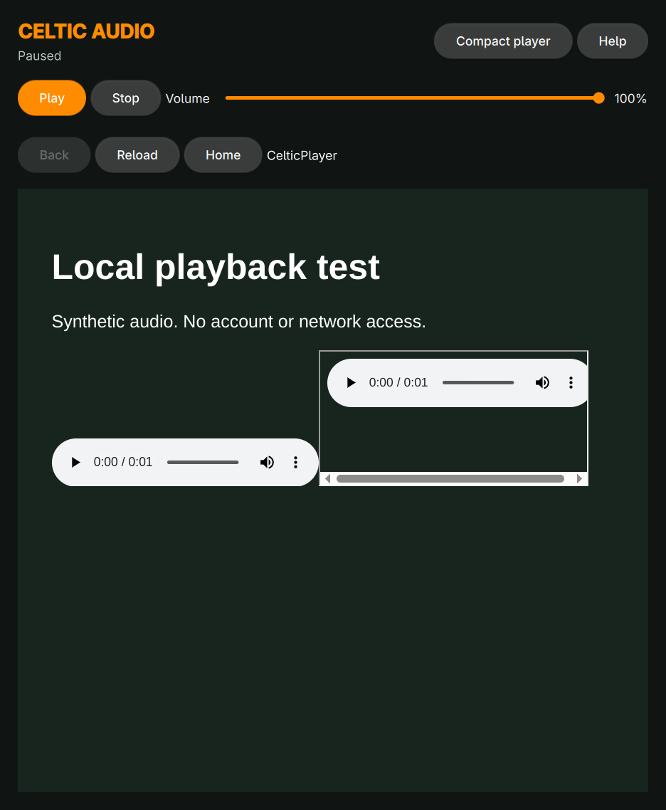

# Celtic Audio



A native Qt Quick app for listening to CelticPlayer on Omarchy, with MPRIS
play/pause, stop, volume and raise-window controls. Unofficial personal utility;
requires your own CelticPlayer account and access to the selected stream.

## Use

Launch **Celtic Audio** from Super+Space, or run `celtic-audio`.
Sign in on the official CelticPlayer page and start a stream. Switch to
**Compact player** for the native listening view. Playback continues while the
window is minimized or closed. Closing hides the window; Quit ends playback.

A headphone button sits immediately beside the Elsewhen world clock. Click it
for Open player, Play/Pause and Quit Celtic Audio. Middle-click toggles playback.
The button remains available when the app is not running and can launch it.
Reopening from the launcher raises the existing player rather than starting
a second instance. The installed user widget is backed by the source in
`omarchy/icd.celtic-audio/`; its layout entry is in Omarchy shell.json.

The app uses a separate persistent WebEngine profile, so sign in once even if
you already signed in to the earlier probe. Website cookies control session
expiry. The app does not save your password separately or log page console data.
The site remains responsible for subscription access, authentication and DRM.

| Shortcut | Action |
| --- | --- |
| Space | Play/pause in compact view |
| Ctrl+L | Toggle website/compact view |
| ? | Show help in compact view |
| Q | Quit in compact view |
| Ctrl+Q | Quit in either view |

MPRIS service: `org.mpris.MediaPlayer2.celtic_audio`.
For an explicitly targeted command, if playerctl is installed:
`playerctl --player=celtic_audio play-pause`.

Stop pauses the media element without seeking; live-stream resume behavior is
controlled by CelticPlayer. Seek, skip, and playback speed are unavailable.
The desktop metadata uses a generic CelticPlayer title. Stream selection stays
on the official page; compact mode does not convert video streams to audio-only.
Start playback on the site once so the browser's user-gesture requirement is met.

The shell follows Omarchy's accent, window rounding and language selection live.
English and a partial Danish catalog are included; missing translations fall
back to English. CelticPlayer's own interface is controlled by the site.
No Omarchy configuration is changed.

## Build and install

```sh
./bin/build
./bin/test
./bin/install
```

The installer builds an Arch package and uses pacman through makepkg to install
it. Dependencies are listed in `pkgbuild/PKGBUILD`. The source uses Qt WebEngine
frame APIs available since Qt 6.8. Build artifacts stay in `build/`.

Uninstall with `sudo pacman -R celtic-audio`. Profile data is retained in Qt's
standard application data/cache locations under `LocalTools/celtic-audio`.

## Validation

- Seven Qt Test checks pass, covering observed playback state, command gating,
  volume bounds, theme loading and Danish translation.
- Exercised actual D-Bus Play, Pause, PlayPause, Stop and Volume against local
  audio in an embedded frame. Observed Playing/Paused transitions from the
  media element, rather than assuming a command succeeded.
- Visually inspected the real QML window using the bundled synthetic audio page.
- Earlier Qt WebEngine probe: user confirmed CelticPlayer audio playback.
- Version 0.2: visually verified the bar icon and popup beside Elsewhen.
- Final installed app: real CelticPlayer media controls still need user testing
  after sign-in. Website changes, shadow-DOM media or unusual player internals
  may require adapting the frame media detection.

`./build/celtic-audio --test-media` opens the bundled local audio fixture and
writes `test-preview.png` after four seconds. This mode allows programmatic
playback for testing; normal mode requires an initial user gesture.

Theme/translation helpers follow the Omarchy app templates; see LICENSE.
